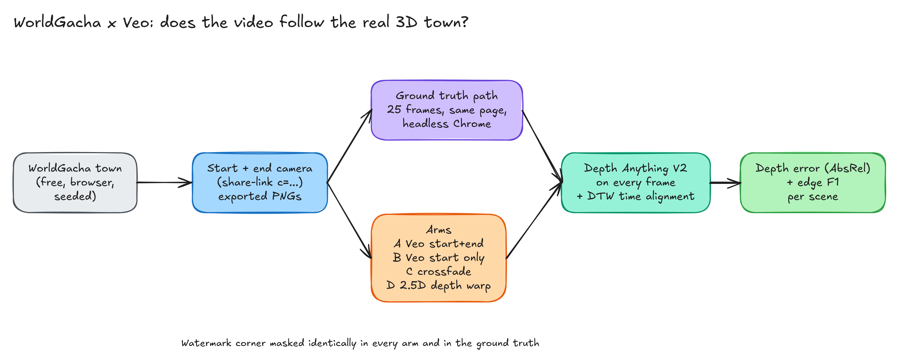
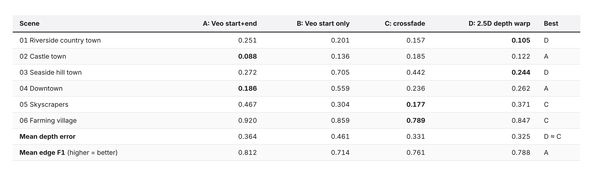

# WorldGacha × Veo: does an AI video follow the real 3D street?

A pre-registered test. [WorldGacha](https://tools.oyasumi-gamedev.com/worldgacha/?lang=en), a free in-browser procedural 3D town generator, provides start and end keyframes **and** the true camera path between them. Four ways of filling an 8 s, 35–40 m forward move are scored against that path:

| Arm | What it is |
|---|---|
| A | Veo 3.1 Fast (Google Flow), start + end frame |
| B | Veo 3.1 Fast, start frame only |
| C | linear RGB crossfade |
| D | 2.5D depth warp of the start frame along the true path (depth scale fitted to the end frame) |

## Result (n = 6 towns, one clip per arm; primary metric = Depth Anything V2 AbsRel after scale+shift alignment, DTW-matched)
| Hypothesis | Mean depth-error reduction [95% CI] | Verdict |
|---|---:|---|
| H1: end frame helps Veo (A vs B, bar ≥ 10%) | +13% [−23, +48] | INCONCLUSIVE (edge F1 +14% [+7, +21]) |
| H2: Veo A beats crossfade C | −21% [−86, +30] | INCONCLUSIVE |
| H3: Veo B beats depth warp D | −65% [−129, −10] | **DISPROVEN** (D better in 5/6) |
| H4: depth warp D beats crossfade C | −3% [−50, +32] | INCONCLUSIVE |
| H5: share link reproduces the town | 13/15 checks pass; failures are 0.1 m camera rounding | INCONCLUSIVE (town deterministic) |

The original, denser protocol (33 clip frames, 25 GT frames, 518 px depth) gives the same verdicts: `results_fullres/`, `figures/table_robustness.png`.

## Layout
| Path | What |
|---|---|
| `DESIGN.md` | design, pre-registered hypotheses, Amendments 1–2 and Clarifications 2–6, all timestamped before the data they affect was scored |
| `BROWSER_BRIEF.md`, `FLOW_BRIEF.md` | exact instructions used for the browser towns and the Veo clips (prompts verbatim) |
| `browser/` | start/end PNGs, recipes, `links.tsv` (share links), manifest, reload checks, UI screenshots (`doc/`) |
| `flow_inputs/` | the 16:9 keyframes given to Veo |
| `flow/` | the 12 Veo clips (watermarked as delivered), `pilot_log.md` (credits, timings), screenshots |
| `gt/sceneNN/capture_log.json` | ground-truth camera path logs (the PNG frames aren't in git, about 190 MB; re-render with `capture.py`) |
| `mask.json` | the watermark rectangle greyed in every frame of every arm and the GT |
| `scripts/` | `gen_scenes.py`, `capture.py`, `score.py`, `analyze_wg.py`, `h5_determinism.py`, `variety.py`, `make_visuals.py`, `wgpage.py` |
| `results/`, `results_fullres/` | per-scene JSON, summaries, H5 checks, GLB stats, variety |
| `figures/`, `tables/` | figures, contact sheets, GIFs, table PNGs and their markdown |
| `issues-found/` | 7 issues and how each was handled |
| `_agent_logs/` | timestamped process log |
| `blog/post.md` | the write-up |

See `REPRODUCE.md` for commands.

## Limitations
- 6 towns (user scope cut from 12) and a single Veo sample per town, so the CIs are wide.
- Depth is estimated, not true depth (the same estimator runs everywhere).
- The protocol was cut for CPU time before scoring, and the original was re-run as robustness.
- The watermark corner is masked. Only Veo 3.1 Fast at 720p was tested.

WorldGacha is by Miyadaiku (Oyasumi Game Dev). Its exported images are free to use (see the tool's page). This repo contains only exports plus my own code.
