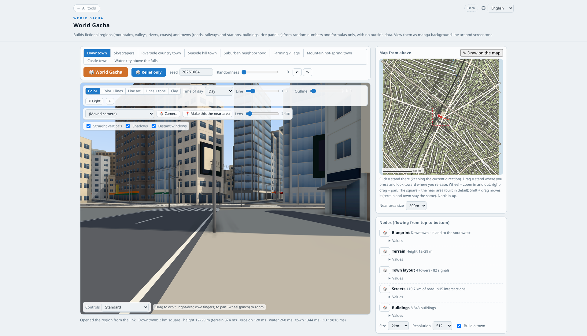
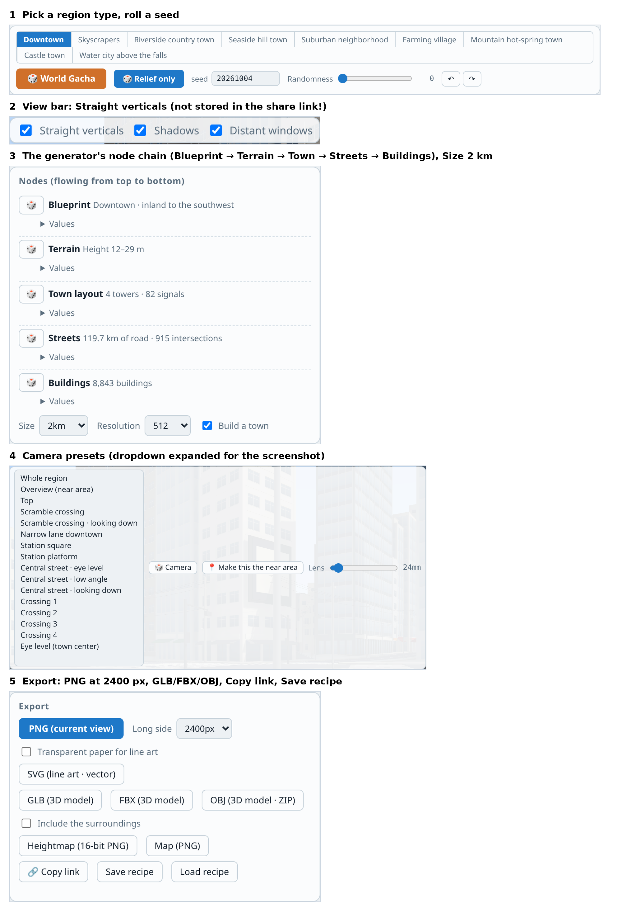
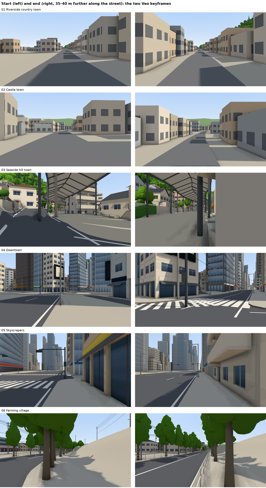
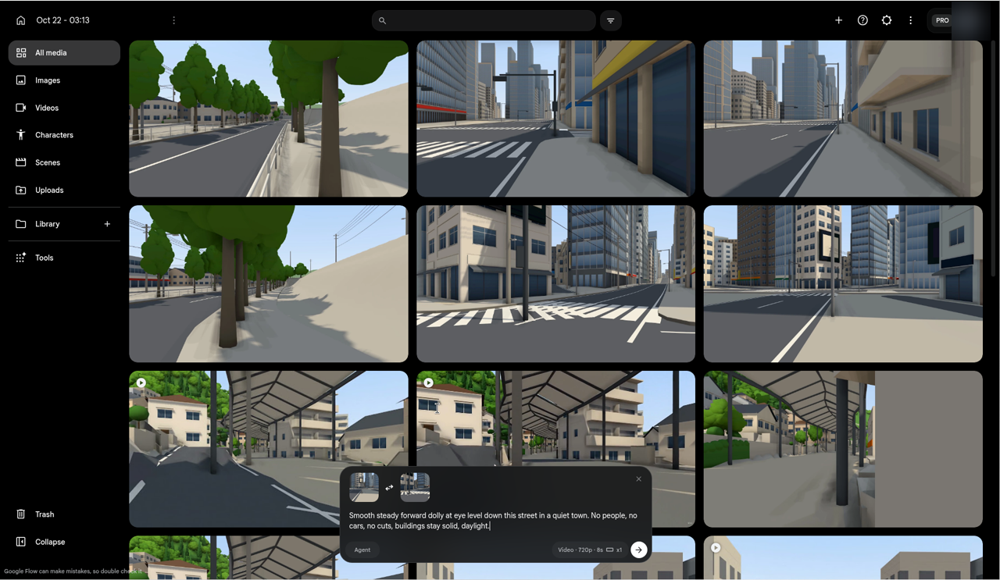
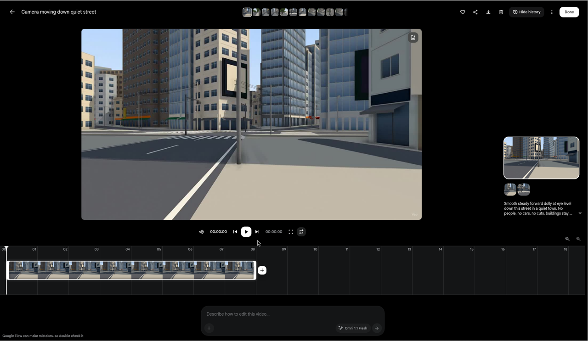

## What WorldGacha is

[WorldGacha](https://tools.oyasumi-gamedev.com/worldgacha/?lang=en) is a free browser tool by Miyadaiku (Oyasumi Game Dev).
- **What it makes:** fictional Japanese regions from a random seed: terrain, rivers, coasts, roads, railways and thousands of buildings, built from formulas with no map data.
- **Where it runs:** entirely in your browser, on three.js.
- **Region types:** nine of them, including downtown, skyscrapers, castle town, riverside, seaside hill town, farming village and hot-spring town.
- **Exports:** PNG at up to 4000 px, SVG line art, GLB/FBX/OBJ 3D models, heightmaps, and a share link that rebuilds the same town.
- **Licence:** the outputs are free for commercial use with no credit needed.

*The app in English: region types and seed on top, the 3D view (colour mode, straight verticals, lens) on the left, a top-down map and the generator's node chain on the right.*

*The five controls that matter for this experiment.*

Two things make it interesting for AI video:
1. It's a **real 3D scene**, so I can render the *true* camera path between any two viewpoints. That's a ground truth a video model can be scored against.
2. It's **deterministic**: the same link always gives the same town. That makes it a reproducible test bench.

## What I tested

*The pipeline. Every arm gets the same two pictures; only the ground truth knows the geometry in between.*

- **6 towns,** one per region type: 01 Riverside country town, 02 Castle town, 03 Seaside hill town, 04 Downtown, 05 Skyscrapers, 06 Farming village.
- **The move:** each town gets a street-level start camera, plus an end camera **35–40 m straight ahead** with the same heading and height. The lens is 24 mm and "Straight verticals" is on.
- **Four ways to fill the 8 seconds in between:**
  - **A, Veo start+end:** Veo 3.1 Fast in Google Flow, given the start *and* end frame.
  - **B, Veo start only:** the same, with only the start frame. The prompt says the camera moves about 40 m ahead.
  - **C, crossfade:** a plain RGB dissolve from start to end, the dumbest possible baseline.
  - **D, 2.5D depth warp:** estimate depth on the start frame, then push it along the *true* camera path. Depth scale is fitted so that warping by the full move best reproduces the end frame, so D also uses both pictures.
- **Ground truth:** the same WorldGacha page, rendered headless along the straight-line camera path between start and end. It's 25 frames from the app's own PNG exporter.
- **Metric:**
  - Depth Anything V2 Small runs on every frame, arm and ground truth alike.
  - Each arm frame's depth is scale+shift-aligned to a ground-truth frame and scored by AbsRel (mean relative depth error).
  - Video models don't move at constant speed, so arm frames are matched to ground-truth frames with **monotone time warping** (DTW, endpoints pinned).
  - The secondary metric is edge F1 (Canny) at 1% of the image diagonal.
  - Lower depth error means the video's 3D layout follows the real street.
- **Watermark:** Flow forces a small "Veo" mark in the bottom-right corner in my region. The same rectangle (80×50 px of 1280×720) is greyed out in **every** frame of every arm *and* in the ground truth, before any metric.
- **Pre-registered:** hypotheses, thresholds, the mask and every protocol change were written down with timestamps before the frames they affect were scored. The bootstrap uses 10,000 resamples over scenes.

*All six keyframe pairs. These exact 16:9 crops (2400×1350) went to Veo.*

## How I built it (and what broke)

### Making the towns
- **01–03, in a desktop browser:** I picked a type, pressed the gacha button once, chose the "In town (shopping street)" camera, set the lens to 24 mm, and exported start and end PNGs at 2400 px.
  - The end camera came from editing the `c=` camera field in the share link (40 m or 35 m further along the heading) and reloading.
  - "Central street · eye level" was tried first, but a tree or wall blocked the view in all three.
- **The desktop browser then gave up.** The box was shared with other heavy jobs (load average about 30), and WorldGacha stopped initialising. It sat on the un-hydrated Japanese page for 10 minutes.
- **04–06, headless:** Chrome with SwiftShader (software WebGL) via Playwright worked. I wrote `gen_scenes.py`:
  - Fixed seeds (20261004/5/6).
  - "Central street · eye level", because "shopping street" only exists for some region types.
  - Lens 24 mm and the same +40 m move, exported through the app's own PNG button.
- **Settings that the share link does *not* store:**
  - Colour render mode
  - Straight verticals
  - People & cars
  - Lens after a preset

  Re-apply them after every load. I learned this the hard way (next section).

*Google Flow, Frames mode. The start and end frame are uploaded; the settings chip reads Veo 3.1 Fast · 720p · 8 s · x1.*

*A finished clip (scene 04, arm A). The small "Veo" watermark sits in the bottom-right corner.*

### Rendering the ground truth headless
- **Capture:** load the start link, set the camera along 25 evenly spaced points between start and end, and click the app's own "PNG (current view)" each time.
- **Getting the image to match the browser:**
  - The browser canvas has an aspect of 1.2507 (2400×1919 exports), so I used a viewport of 1600×1100, which gives the same aspect.
  - Headless loads defaulted to *line art*, so I click "Colour" explicitly.
- **Speed:** 25–70 s per frame on software rendering, so 12–40 min per town.
- **Bug I caught:** "Straight verticals" defaults to *off* headless. My first ground truth for 01–03 was rendered in 3-point perspective, while the browser images were 2-point. After the fix, headless frame 0 matched the desktop browser's start PNG to a mean pixel difference of **0.03/255**, versus 0.76 before. I threw away the first captures.

### Things that went wrong along the way
- **Pinholes in the depth warp:** forward-splatting the start image leaves a grid of holes when the camera moves forward. I fixed it with a 2×2 splat footprint, and the depth-scale fit now minimises error after hole filling. I saw one debug score before the fix and disclosed it.
- **Credits didn't add up once:** Flow quotes 20 credits per Veo 3.1 Fast clip. Four clips queued together cost 30 in total. Six clips submitted one at a time cost exactly 20 each. Total for the experiment: **190 credits for 12 clips**.
- **Depth on CPU was too slow:** under load, one Depth Anything pass took 13–46 s. Before scoring, I cut the protocol to fit the day:
  - 9 frames per clip instead of 33
  - 13 ground-truth frames instead of 25
  - a 182 px depth input instead of 518

  The changes apply to all arms alike and are logged as a pre-registered clarification.
- **Scope:** the plan was 12 towns. I cut it to 6 because of time and the stalled browser.
