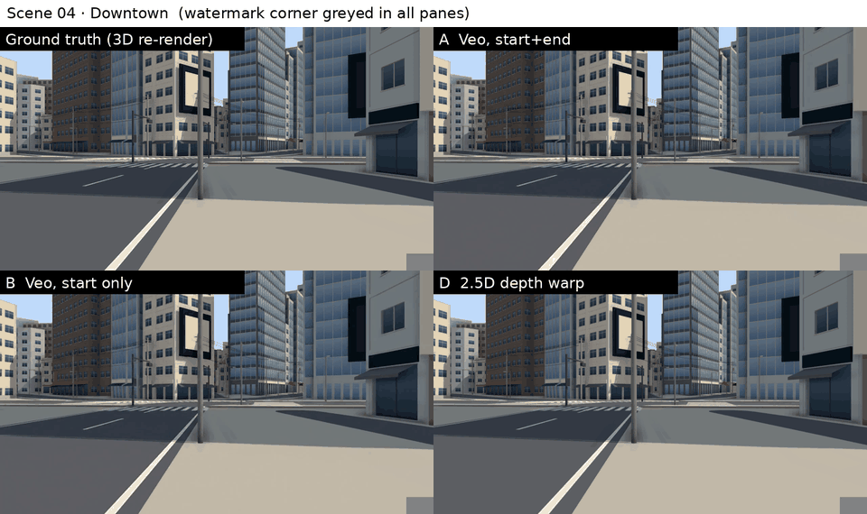
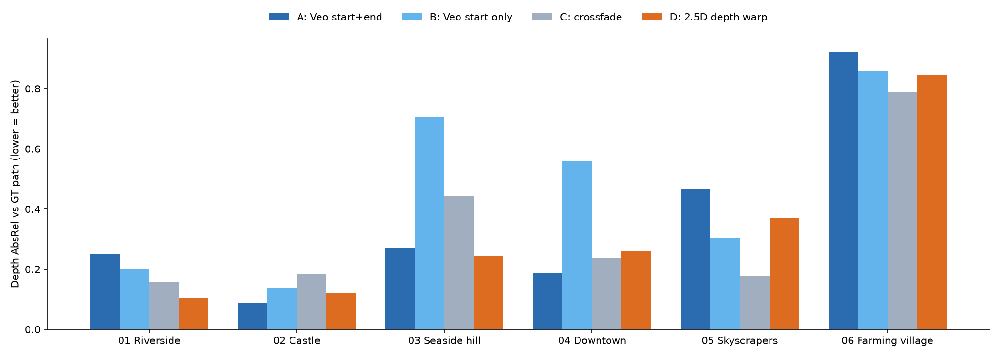
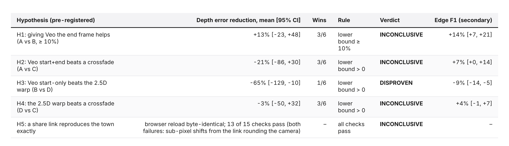
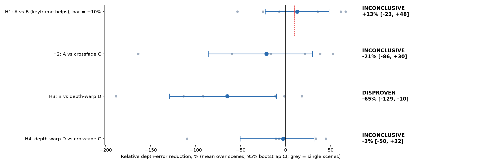
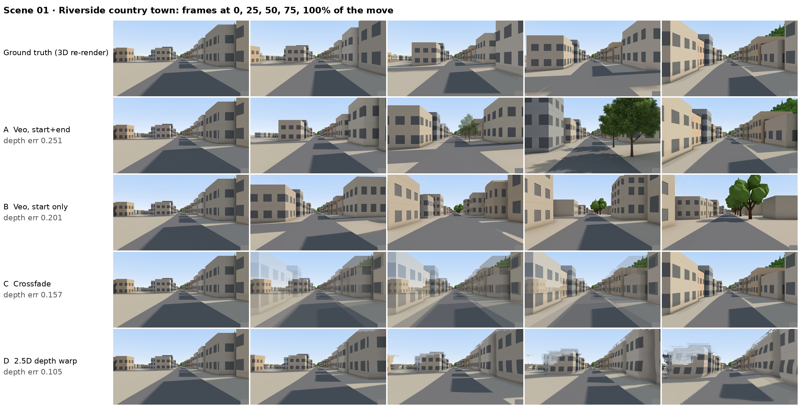
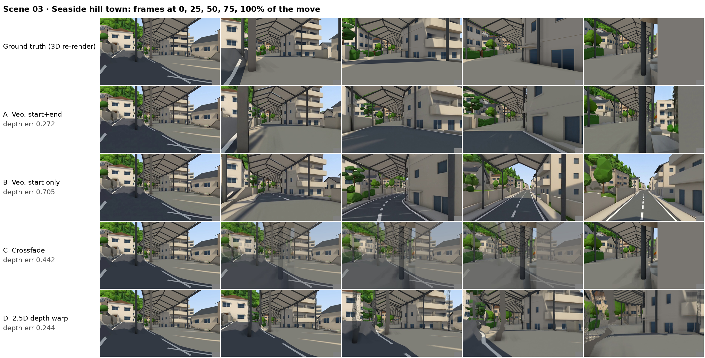
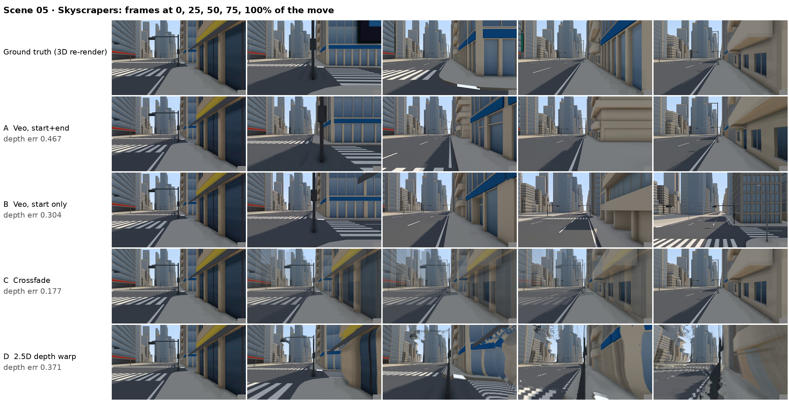
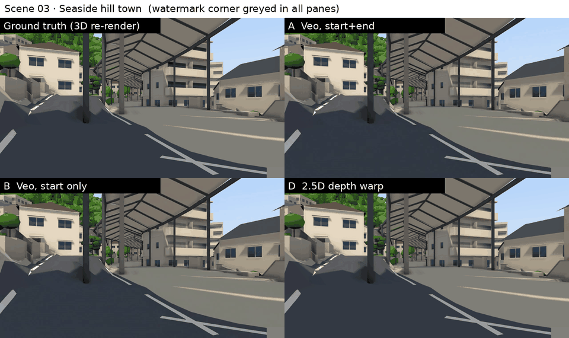
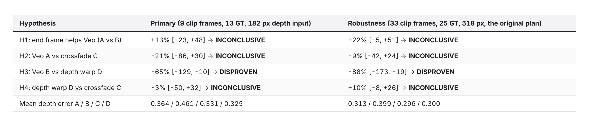
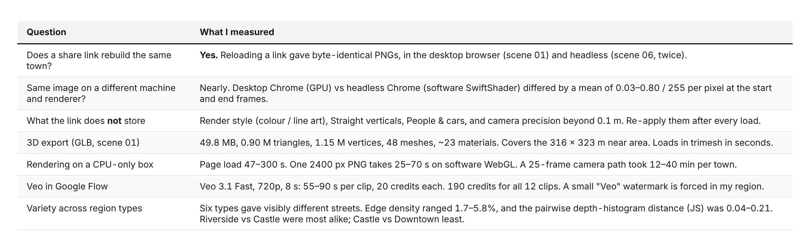

# I gave Veo two frames of a 3D town, then checked its video against the real street

*6 free WorldGacha towns, 12 Veo clips, ground truth rendered from the same 3D scene. Veo looked best on edges, but a free crossfade and a depth warp matched its street geometry.*


*Downtown, a 40 m walk forward. Top left: the true path, rendered from the 3D town. Top right: Veo given the start and end frame. Bottom left: Veo given only the start. Bottom right: a free 2.5D depth warp of the start frame.*

## The short version

- **The idea:** [WorldGacha](https://tools.oyasumi-gamedev.com/worldgacha/?lang=en) is a free in-browser generator of Japanese towns, and the towns are real 3D scenes. I could export a start and an end frame, ask Veo to fill the 8 seconds between them, then render the *actual* camera path and compare.
- **Setup:**
  - 6 towns, 4 methods:
    - Veo with start+end frames
    - Veo with the start frame only
    - a plain crossfade
    - a 2.5D depth warp
  - Depth error is measured with Depth Anything V2.
  - Everything was pre-registered, and the Veo watermark was masked identically everywhere.
- **Giving Veo the end frame:** depth error fell by **13%** on average, and edge match improved by **14%** (CI +7 to +21%). The depth result is too noisy to call (**inconclusive**).
- **Veo start-only vs a free depth warp:** Veo was **worse** on 5 of 6 towns, with 65% more depth error. That one is **disproven**: start-only Veo did not beat a 50-line warp.
- **Veo start+end vs a crossfade:** a tie on depth (−21%, CI −86% to +30%). Veo looks far better, but its geometry wasn't measurably closer to the real street. Veo also invents trees and buildings that aren't there.
- **WorldGacha as a test bench:** excellent. Share links rebuild the town byte-for-byte, headless rendering matches the desktop browser to 0.03/255, and it exports GLB.
- **Cost:** 190 Google Flow credits for 12 clips, plus a CPU box. No GPU.

Thanks for reading Tech in General! Subscribe for free to receive new posts and support my work.

## What WorldGacha is

[WorldGacha](https://tools.oyasumi-gamedev.com/worldgacha/?lang=en) is a free browser tool by Miyadaiku (Oyasumi Game Dev).
- **What it makes:** fictional Japanese regions from a random seed: terrain, rivers, coasts, roads, railways and thousands of buildings, built from formulas with no map data.
- **Where it runs:** entirely in your browser, on three.js.
- **Region types:** nine of them, including downtown, skyscrapers, castle town, riverside, seaside hill town, farming village and hot-spring town.
- **Exports:** PNG at up to 4000 px, SVG line art, GLB/FBX/OBJ 3D models, heightmaps, and a share link that rebuilds the same town.
- **Licence:** the outputs are free for commercial use with no credit needed.


*The app in English: region types and seed on top, the 3D view (colour mode, straight verticals, lens) on the left, a top-down map and the generator's node chain on the right.*


*The five controls that matter for this experiment.*

Two things make it interesting for AI video:
1. It's a **real 3D scene**, so I can render the *true* camera path between any two viewpoints. That's a ground truth a video model can be scored against.
2. It's **deterministic**: the same link always gives the same town. That makes it a reproducible test bench.

## What I tested


*The pipeline. Every arm gets the same two pictures; only the ground truth knows the geometry in between.*

- **6 towns,** one per region type: 01 Riverside country town, 02 Castle town, 03 Seaside hill town, 04 Downtown, 05 Skyscrapers, 06 Farming village.
- **The move:** each town gets a street-level start camera, plus an end camera **35–40 m straight ahead** with the same heading and height. The lens is 24 mm and "Straight verticals" is on.
- **Four ways to fill the 8 seconds in between:**
  - **A, Veo start+end:** Veo 3.1 Fast in Google Flow, given the start *and* end frame.
  - **B, Veo start only:** the same, with only the start frame. The prompt says the camera moves about 40 m ahead.
  - **C, crossfade:** a plain RGB dissolve from start to end, the dumbest possible baseline.
  - **D, 2.5D depth warp:** estimate depth on the start frame, then push it along the *true* camera path. Depth scale is fitted so that warping by the full move best reproduces the end frame, so D also uses both pictures.
- **Ground truth:** the same WorldGacha page, rendered headless along the straight-line camera path between start and end. It's 25 frames from the app's own PNG exporter.
- **Metric:**
  - Depth Anything V2 Small runs on every frame, arm and ground truth alike.
  - Each arm frame's depth is scale+shift-aligned to a ground-truth frame and scored by AbsRel (mean relative depth error).
  - Video models don't move at constant speed, so arm frames are matched to ground-truth frames with **monotone time warping** (DTW, endpoints pinned).
  - The secondary metric is edge F1 (Canny) at 1% of the image diagonal.
  - Lower depth error means the video's 3D layout follows the real street.
- **Watermark:** Flow forces a small "Veo" mark in the bottom-right corner in my region. The same rectangle (80×50 px of 1280×720) is greyed out in **every** frame of every arm *and* in the ground truth, before any metric.
- **Pre-registered:** hypotheses, thresholds, the mask and every protocol change were written down with timestamps before the frames they affect were scored. The bootstrap uses 10,000 resamples over scenes.


*All six keyframe pairs. These exact 16:9 crops (2400×1350) went to Veo.*

## How I built it (and what broke)

### Making the towns
- **01–03, in a desktop browser:** I picked a type, pressed the gacha button once, chose the "In town (shopping street)" camera, set the lens to 24 mm, and exported start and end PNGs at 2400 px.
  - The end camera came from editing the `c=` camera field in the share link (40 m or 35 m further along the heading) and reloading.
  - "Central street · eye level" was tried first, but a tree or wall blocked the view in all three.
- **The desktop browser then gave up.** The box was shared with other heavy jobs (load average about 30), and WorldGacha stopped initialising. It sat on the un-hydrated Japanese page for 10 minutes.
- **04–06, headless:** Chrome with SwiftShader (software WebGL) via Playwright worked. I wrote `gen_scenes.py`:
  - Fixed seeds (20261004/5/6).
  - "Central street · eye level", because "shopping street" only exists for some region types.
  - Lens 24 mm and the same +40 m move, exported through the app's own PNG button.
- **Settings that the share link does *not* store:**
  - Colour render mode
  - Straight verticals
  - People & cars
  - Lens after a preset

  Re-apply them after every load. I learned this the hard way (next section).


*Google Flow, Frames mode. The start and end frame are uploaded; the settings chip reads Veo 3.1 Fast · 720p · 8 s · x1.*


*A finished clip (scene 04, arm A). The small "Veo" watermark sits in the bottom-right corner.*

### Rendering the ground truth headless
- **Capture:** load the start link, set the camera along 25 evenly spaced points between start and end, and click the app's own "PNG (current view)" each time.
- **Getting the image to match the browser:**
  - The browser canvas has an aspect of 1.2507 (2400×1919 exports), so I used a viewport of 1600×1100, which gives the same aspect.
  - Headless loads defaulted to *line art*, so I click "Colour" explicitly.
- **Speed:** 25–70 s per frame on software rendering, so 12–40 min per town.
- **Bug I caught:** "Straight verticals" defaults to *off* headless. My first ground truth for 01–03 was rendered in 3-point perspective, while the browser images were 2-point. After the fix, headless frame 0 matched the desktop browser's start PNG to a mean pixel difference of **0.03/255**, versus 0.76 before. I threw away the first captures.

### Things that went wrong along the way
- **Pinholes in the depth warp:** forward-splatting the start image leaves a grid of holes when the camera moves forward. I fixed it with a 2×2 splat footprint, and the depth-scale fit now minimises error after hole filling. I saw one debug score before the fix and disclosed it.
- **Credits didn't add up once:** Flow quotes 20 credits per Veo 3.1 Fast clip. Four clips queued together cost 30 in total. Six clips submitted one at a time cost exactly 20 each. Total for the experiment: **190 credits for 12 clips**.
- **Depth on CPU was too slow:** under load, one Depth Anything pass took 13–46 s. Before scoring, I cut the protocol to fit the day:
  - 9 frames per clip instead of 33
  - 13 ground-truth frames instead of 25
  - a 182 px depth input instead of 518

  The changes apply to all arms alike and are logged as a pre-registered clarification.
- **Scope:** the plan was 12 towns. I cut it to 6 because of time and the stalled browser.
## Results


*Depth error per town (AbsRel after scale+shift alignment, mean over the clip's interior frames; lower is better). Bold = best in that town. The bottom row is the secondary edge F1, where higher is better.*


*The same numbers as bars. No method wins everywhere. The farming village (06) is hard for all of them, because the camera walks past tree trunks a metre away.*


*Pre-registered verdicts. Ratios are means over the 6 towns with 95% bootstrap CIs. "Wins" counts towns where the first method had lower error.*


*Each line is one hypothesis. A dot left of zero means the first-named method had more depth error. Grey dots are single towns.*

### Finding 1: the end frame helps Veo stay on the street, but only modestly

With only a start frame, Veo has to guess where "40 m ahead" is. Sometimes it guessed well (castle, skyscrapers). Sometimes it turned or invented a new street: in the seaside town, B's depth error was 0.70 against A's 0.27.

Adding the end frame cut depth error by 13% on average, and edge F1 rose 14% (CI +7 to +21%, 5 of 6 towns). But two towns went the other way, so on the pre-registered depth metric the interval (−23% to +48%) doesn't clear my 10% bar. **Inconclusive**, leaning yes.

### Finding 2: start-only Veo lost to a free depth warp

The depth-warp baseline estimates depth once on the start image and pushes the pixels along the true camera path. It's deliberately naïve: no inpainting model, just OpenCV hole filling. It tears and smears near the end (bottom-right panel in the GIF).

Even so, its *geometry* stays roughly right, because it follows the real camera path. Start-only Veo had more depth error than the warp in 5 of 6 towns (mean +65%, CI +10% to +129%). By my pre-registered rule that's **disproven**: Veo given one frame does not follow the street better than a warp.

That's not entirely fair to Veo. The warp knows the true camera motion and Veo only has a text prompt. But it's the comparison a practitioner would make.

### Finding 3: a crossfade tied Veo start+end on geometry

This surprised me. A crossfade is two still images dissolving into each other, which looks awful (row C in the sheets). Yet its depth error was no worse than Veo's start+end clip.

The reason is visible in the contact sheets. Veo's clips are fluent, but *they wander*:
- In the riverside town it plants a large tree in the middle of the street that isn't in the 3D scene.
- In the skyscraper district its middle frames put the walls and the corner at different distances than the real path.

A crossfade can't invent anything, so its depth is always "somewhere between two correct answers".

Edge F1, which rewards sharp structures in the right places, did favour Veo A slightly (+7%, CI 0 to +14%). Veo is the most *plausible* video. It isn't measurably the most *faithful*.


*Riverside (01). Both Veo clips grow a large tree that isn't in the 3D town (rows 2–3). The warp (row 5) stays on the true street but smears at the end.*


*Seaside hill town (03). Start-only Veo (row 3) leaves the covered arcade for an open road that doesn't exist. With the end frame (row 2), it stays under the arcade.*


*Skyscrapers (05), where the crossfade won. Veo's frames look right, but they put the walls and the corner at different distances than the true path.*


*Seaside hill town, all four views playing.*

### Robustness: the original, denser protocol gives the same verdicts

Scoring had to be cut down (9 frames per clip, 182 px depth) when the shared box was overloaded. Once it freed up, I re-ran the **original** pre-registered density: 33 frames per clip, all 25 ground-truth frames, and the default 518 px depth input.

Every verdict came out the same. H1 moved to +22% (still inconclusive), and the warp-vs-crossfade comparison went from −3% to +10% (still inconclusive). I report the cut-down run as primary because that protocol was fixed before any score existed.


*Primary vs robustness scoring. The verdicts don't change.*

## Is WorldGacha a good test bench?


*Reproducibility and practical value, measured along the way.*

- **Reproducibility is the standout.** The same share link gives a byte-identical image after a reload, and a software renderer on another machine gives an image within 0.03/255 of the desktop GPU's.
  - My one H5 "failure" was self-inflicted. The link rounds the camera to 0.1 m, so re-opening a link isn't the *exact* camera I had exported from. That gives a sub-pixel shift at building edges (scenes 02 and 06).
  - By my strict rule (every check must pass) H5 is therefore **inconclusive**, but the town itself never changed.
- **Watch the settings the link doesn't store.** This bit me once: my first ground truth was rendered without Straight verticals.
- **GLB export works:** a 50 MB, 0.9 M-triangle model of the 300 m near area, usable in Blender or three.js.
- **Variety:** the six types gave clearly different streets (edge density 1.7–5.8%), from low village houses to glass towers. Riverside and Castle towns were the most alike.

## How to reproduce

The repo has everything: [github.com/nankris/worldgacha-veo-camera-path](https://github.com/nankris/worldgacha-veo-camera-path).

```bash
pip install playwright numpy pillow opencv-python-headless torch transformers trimesh matplotlib
cd scripts
python gen_scenes.py                 # headless towns + start/end PNGs (Chrome + SwiftShader, no GPU)
python crop16x9.py                   # the exact 16:9 keyframes given to Veo
# Veo: Google Flow, Frames mode, Veo 3.1 Fast, 16:9, 720p, 8 s, x1. Prompts verbatim in FLOW_BRIEF.md
bash capture_queue.sh                # ground-truth camera path, 25 frames per town
WG_SELFTEST=1 python score.py 01     # sanity: ground truth vs itself = 0.000
python score.py && python analyze_wg.py && python h5_determinism.py && python make_visuals.py
WG_FULL=1 python score.py && WG_FULL=1 python analyze_wg.py   # robustness run
```

Prompt A: *"Smooth steady forward dolly at eye level down this street in a quiet town. No people, no cars, no cuts, buildings stay solid, daylight."* Prompt B adds *"The camera moves about 40 metres straight ahead."*

## Limitations

- **6 towns, one clip each.** The plan was 12. I cut it to 6 because of time and a stalled browser, recorded before any scoring. With one Veo sample per town, the CIs are wide, and three of five verdicts are inconclusive for that reason.
- **The metric is a proxy.** Depth Anything V2 on rendered frames isn't true depth, though the same estimator runs on every arm and on the ground truth. Depth error also doesn't punish a crossfade's ghosting, which is why it scores so well. Edge F1 partly compensates.
- **Protocol cut for CPU time:** coarser frame sampling and depth resolution, decided before scoring. The original density gives the same verdicts.
- **Scenes 04–06 differ slightly from 01–03.** They were made headless with fixed seeds and a different camera preset ("Central street · eye level"). Scene 03 moved 35 m, but its prompt said "about 40 metres".
- **Watermark:** a 80×50 px corner is greyed in every frame of every method.
- **Veo settings:** only Veo 3.1 Fast at 720p was tested. Other models, longer clips or better prompts might do better.
- **One shared, heavily loaded CPU box.** Timings are pessimistic.

## Bottom line

If you want a video *of a place that exists*, Veo's beautiful frames are not evidence it followed the place. With only a start frame it wandered further from the real street than a free depth warp. Giving it the end frame helped, but on geometry it still only tied a crossfade.

WorldGacha turned out to be the real find: a free, deterministic, exportable 3D town generator that makes this kind of test cheap and repeatable. The obvious next step is more towns and several Veo samples per town, so the verdicts can firm up.
